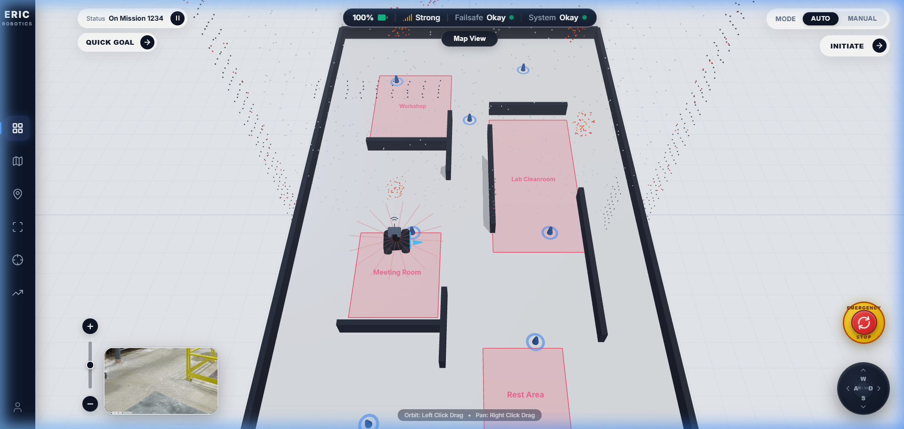
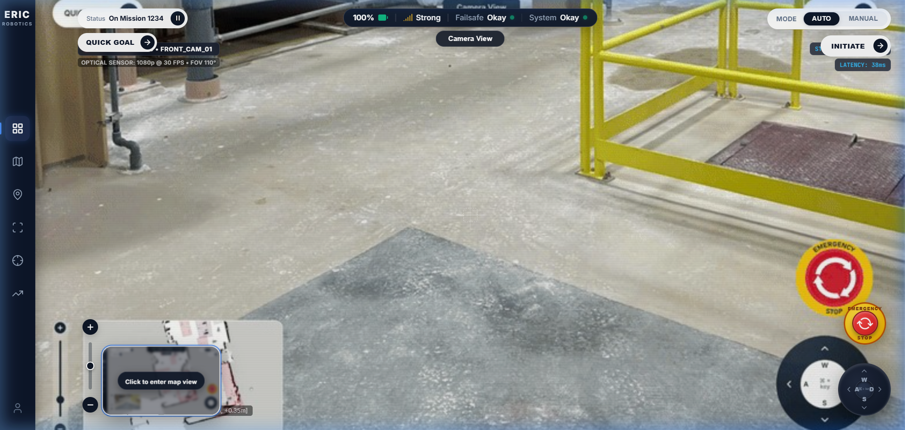
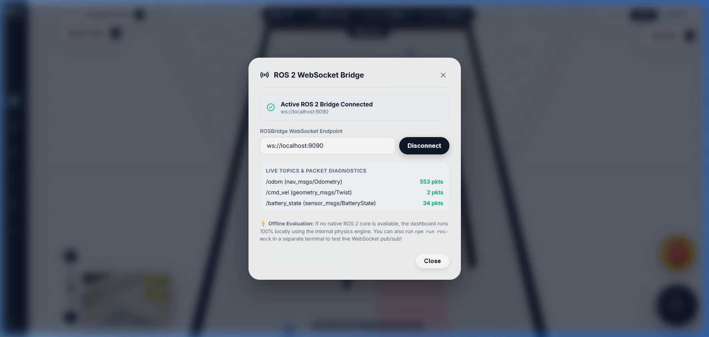
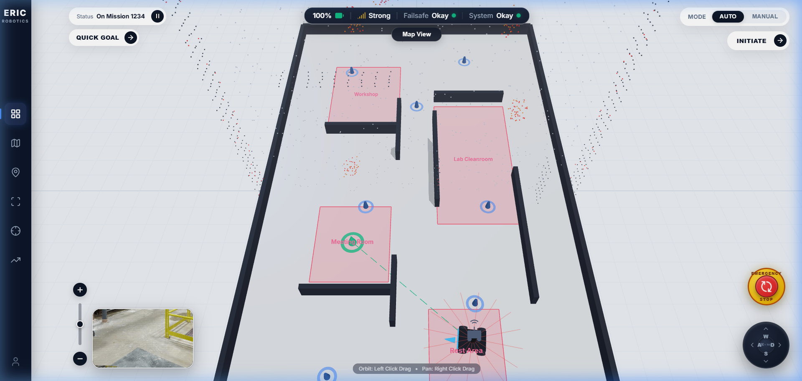
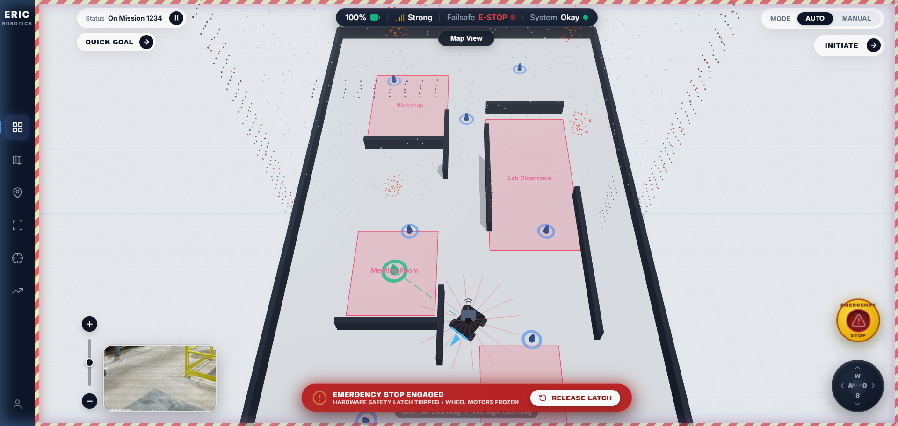

<div align="center">

  

  # ERIC ROBOTICS &bull; INSIGHT.IO
  ### Autonomous Mobile Robot (AMR) Mission Control & 3D Telemetry Platform

  [](https://react.dev/)
  [](https://www.typescriptlang.org/)
  [](https://threejs.org/)
  [](https://docs.ros.org/)
  [](https://www.docker.com/)
  [](http://localhost:5173)

  <p align="center">
    <strong>A production-grade, self-hosted mission control dashboard faithfully engineered for ERIC Robotics AMR platforms.</strong><br/>
    Featuring interactive 3D SLAM point clouds, real-time optical feed streaming, smooth 450ms PiP viewport swap, industrial teleoperation, safety-latched E-Stop, and native ROS 2 WebSocket integration.
  </p>

</div>

---

## Candidate Information

- **Full Name**: Yash Agrawal
- **Email ID**: agrawalyash994@gmail.com
- **Contact Number**: +91 6353902576
- **GitHub Repository**: [https://github.com/yash9025/Eric-Robotics](https://github.com/yash9025/Eric-Robotics)

---

## Visual Gallery & Operational Telemetry

| 1. 3D SLAM Map & PCD Point Cloud | 2. Camera View & PiP Swap Engine |
| :---: | :---: |
|  |  |

| 3. Live ROS 2 Bridge WebSocket Diagnostics | 4. Quick Goal Trajectory Dispatch |
| :---: | :---: |
|  |  |

<div align="center">
  <p><strong>5. Industrial Safety Emergency Stop (Hardware Latch & Screen-Edge Hazard Flashing)</strong></p>
  
</div>

---

## System Overview

This implementation represents a faithful recreation of the **ERIC Robotics Insight.IO** dashboard. Designed from the ground up for industrial fleet deployments, the application provides real-time situational awareness, manual overrides, and autonomous supervision:

- **3D SLAM Digital Twin**: Three.js isometric rendering engine displaying an occupancy floor grid, extruded warehouse perimeter walls, translucent polygonal functional zones (*Workshop*, *Meeting Room*, *Lab Cleanroom*, *Rest Area*) with billboarded labels, and a high-density `.pcd` LiDAR obstacle point cloud.
- **Resilient Optical Stream**: High-throughput optical camera stream featuring a canvas image-sequence pipeline (guaranteeing 100% offline playback across all operating systems without external codec dependencies) overlaid with an optical reticle HUD indicating yaw, pitch, roll, and latency.
- **Picture-in-Picture (PiP) Swap Engine**: Seamless 450ms cubic-bezier transition mechanism allowing operators to swap the primary viewport and thumbnail feed via the bottom-left thumbnail card or the top mode switcher.
- **Industrial Teleoperation**: Responsive 4-axis D-Pad and full keyboard binding (`W`, `A`, `S`, `D` and arrow keys) publishing `/cmd_vel` velocity twists.
- **Emergency Stop Safety Interlock**: Industrial E-Stop button with safety latching, full-viewport flashing hazard border, and hardware de-energization banner.
- **Dual-Mode Data Architecture**: Runs 100% offline out-of-the-box using an internal kinematic physics engine, while supporting live connection to ROS 2 via `ws://localhost:9090`.

---

## Architecture & Data Flow

```
┌─────────────────────────────────────────────────────────────────────────────┐
│                       INSIGHT.IO DASHBOARD ARCHITECTURE                     │
└─────────────────────────────────────────────────────────────────────────────┘

  ┌───────────────────┐    ┌──────────────────────────────────────────────┐
  │   Sidebar (Nav)   │    │            Top Telemetry Capsule             │
  │  - Dashboard Icon │    │  - Battery % | Signal/ROS Link | Failsafe    │
  │  - Maps / Zones   │    │  - System Health | [Map View | Camera View]  │
  │  - Teleoperation  │    └──────────────────────────────────────────────┘
  └───────────────────┘                           │
            │                                     ▼
            │               ┌──────────────────────────────────────────────┐
            ├──────────────►│         ViewportContainer (PiP Engine)       │
            │               │  ┌────────────────────┐ ┌──────────────────┐ │
            │               │  │   Primary Stage    │ │  PiP Thumbnail   │ │
            │               │  │  (3D Map / Camera) │ │  (Bottom-Left)   │ │
            │               │  └────────────────────┘ └──────────────────┘ │
            │               └──────────────────────────────────────────────┘
            │                                     ▲
            │         ┌───────────────────────────┴────────────────────────┐
            ▼         ▼                                                    ▼
  ┌─────────────────────────┐                            ┌────────────────────────┐
  │   Three.js 3D SLAM      │                            │  Camera Feed Canvas    │
  │ - SceneManager (Orbit)  │                            │ - 30 FPS Streamer      │
  │ - GridMapMesh (Zones)   │                            │ - Reticle HUD Overlay  │
  │ - PCDVisualizer (.pcd)  │                            │ - Zero Codec Fallback  │
  │ - RobotMarker (Heading) │                            └────────────────────────┘
  └─────────────────────────┘
            ▲
            │
  ┌────────────────────────────────────────────────────────────────────────────┐
  │                     RobotStateContext (State Bus)                          │
  │  - Pose (x, y, yaw)  - Velocities (v, ω)  - E-Stop Latch  - Goal Tracking  │
  └────────────────────────────────────────────────────────────────────────────┘
            ▲                                     ▲
            │ (Simulated Loop)                    │ (Live Bridge)
  ┌─────────────────────────┐           ┌──────────────────────────────────────┐
  │ Local Kinematic Engine  │           │   RosBridgeClient (roslibjs)         │
  │ - Autonomous Wander     │           │ - Topics: /odom, /cmd_vel, /battery  │
  │ - Waypoint Navigation   │           │ - Endpoint: ws://localhost:9090      │
  └─────────────────────────┘           └──────────────────────────────────────┘
                                                          ▲
                                                          │ WebSocket
                                        ┌──────────────────────────────────────┐
                                        │ Native ROS 2 Core OR npm run ros-mock│
                                        └──────────────────────────────────────┘
```

---

## Deployment & Self-Hosting

The dashboard is self-hosted and requires zero external network calls. You can launch it using any of the following 4 methods:

### Method 1: Local Development Server (Recommended)
Prerequisites: Node.js 18+ and npm.

```bash
# 1. Install dependencies
npm install

# 2. Start the Vite development server
npm run dev

# Dashboard opens at: http://localhost:5173
```

### Method 2: Single-Command Docker Compose
Prerequisites: Docker and Docker Compose.

```bash
# Launch both Dashboard (port 3000) and Mock ROS 2 Bridge (port 9090)
docker compose up --build

# Open browser at: http://localhost:3000
```

### Method 3: Production Static Build (Python / Nginx / Node)

```bash
# Build production bundle
npm run build

# Serve statically via Python
python -m http.server 3000 --directory dist

# Or serve via Node npx
npx serve dist -p 3000

# Open browser at: http://localhost:3000
```

### Method 4: Launching with Live ROS 2 Mock Bridge

```bash
# In terminal 1: Start mock ROS 2 WebSocket bridge
npm run ros-mock

# In terminal 2: Start frontend dashboard
npm run dev

# In the dashboard, click the top signal pill to open the ROS Bridge modal and click "Connect".
```

---

## ROS 2 Integration & Communication Protocol

The dashboard integrates with ROS 2 through `roslib` over standard WebSocket (`rosbridge_websocket` on port 9090).

### Supported Topics

| Topic | ROS Message Type | Direction | Functional Purpose |
| :--- | :--- | :---: | :--- |
| `/odom` | `nav_msgs/Odometry` | Sub | Updates AMR 3D position $(x, y)$ and yaw orientation in Three.js |
| `/battery_state` | `sensor_msgs/BatteryState` | Sub | Live battery percentage and discharge telemetry in top capsule |
| `/camera/image_raw/compressed` | `sensor_msgs/CompressedImage` | Sub | Subscribes to live JPEG/PNG camera stream from robot camera |
| `/cmd_vel` | `geometry_msgs/Twist` | Pub | Linear ($x$) and angular ($z$) velocity commands from Teleop D-Pad |
| `/goal_pose` | `geometry_msgs/PoseStamped` | Pub | Dispatches coordinate goal targets from Quick Goal modal |
| `/emergency_stop` | `std_msgs/Bool` | Pub | Publishes `true`/`false` hardware safety latch command |

### Connecting to a Native ROS 2 Core

If you have a native ROS 2 distribution (Humble, Iron, or Jazzy) installed:

```bash
# 1. Install rosbridge suite
sudo apt-get install ros-${ROS_DISTRO}-rosbridge-suite

# 2. Launch WebSocket Bridge
ros2 launch rosbridge_server rosbridge_websocket_launch.xml

# 3. (Optional) Play recorded rosbag file
ros2 bag play my_warehouse_run.db3

# 4. In the dashboard, click the Signal pill at top, verify ws://localhost:9090, and click "Connect"
```

---

## Core Operational Capabilities

### 1. Interactive 3D SLAM Map & PCD Point Cloud
- **Three.js Isometric Scene**: Restricted OrbitControls prevent disorientation while allowing smooth panning, orbiting, and zooming.
- **PCD Point Cloud**: Loaded via `PCDLoader` reading [`public/assets/warehouse_slam.pcd`](public/assets/warehouse_slam.pcd) with red LiDAR obstacle return points along corridor walls.
- **Extruded 3D Floor Plan**: Perimeter walls, door frames, and translucent pink zones (*Workshop*, *Meeting Room*, *Lab Cleanroom*, *Rest Area*) with billboard text.
- **Dynamic 3D Rover**: Chassis, wheels, rotating LiDAR turret, heading vector, and animated ping beacons.

### 2. Camera Feed & PiP Swap Engine
- **Codec-Resilient Video Pipeline**: Streams offline 30 FPS extracted camera frames with zero external codec requirements.
- **Crosshair Reticle HUD**: Optical targeting frame displaying active sensor pose (yaw, pitch, roll) and frame latency.
- **PiP Swap Transition**: Click the bottom-left thumbnail card or the top `Map View` / `Camera View` pill to smoothly swap primary and thumbnail views in 450ms.

### 3. Industrial Teleoperation & Safety Latch
- **D-Pad Controls**: 4-axis control pad with directional buttons for mouse click/touch.
- **Keyboard Listeners**: `W`/`S` (Forward/Reverse), `A`/`D` (Steer Left/Right), or Arrow keys.
- **Safety E-Stop**: Yellow ring industrial button. Clicking trips the safety latch, flashes a red viewport hazard border, de-energizes motor drive, and notifies hardware over `/emergency_stop`.

### 4. Interactive Mission Controls
- **Quick Goal**: Modal dialog allowing coordinates dispatch (`Workshop`, `Lab`, `Meeting Room`, `Rest Area`, or custom $X, Y$) with 3D cone marker and dashed trajectory line.
- **Initiate Mission**: Preflight safety verification checklist with mission start dispatch.
- **Mode Toggle**: Switch between `AUTO` (autonomous patrol) and `MANUAL` (teleoperation override).

---

## Project Structure

```
Eric Robotics/
├── public/
│   └── assets/
│       ├── camera_frames/          # 35 pristine JPEG frames for 100% offline camera
│       ├── robot_feed.mp4          # Extracted warehouse video feed
│       ├── warehouse_slam.pcd      # 3D LiDAR point cloud (.pcd)
│       ├── warehouse_map.png       # 2D SLAM occupancy grid
│       └── robot_logo.svg          # ERIC Robotics vector logo
├── server/
│   └── mock_ros_bridge.js          # Standalone Node.js ROS 2 WebSocket Bridge (port 9090)
├── src/
│   ├── components/
│   │   ├── controls/               # EmergencyStopButton, TeleopDPad, EmergencyHazardOverlay
│   │   ├── layout/                 # Sidebar, TopTelemetryBar, MissionControlOverlay, ZoomSlider
│   │   ├── modals/                 # QuickGoalModal, InitiateMissionModal, RosBridgeModal
│   │   └── viewport/               # ViewportContainer (PiP), Map3DView, CameraFeedView, PiPThumbnail
│   ├── context/
│   │   └── RobotStateContext.tsx   # Global state bus, dead reckoning, and ROS Bridge link
│   ├── ros/
│   │   ├── rosTopics.ts            # ROS 2 message definitions & topic schemas
│   │   └── RosBridgeClient.ts      # Multi-subscriber roslibjs WebSocket client
│   ├── three/
│   │   ├── SceneManager.ts         # Three.js isometric renderer and OrbitControls
│   │   ├── GridMapMesh.ts          # Extruded walls, floor grid, and labeled pink zones
│   │   ├── PCDVisualizer.ts        # Three.js PCDLoader LiDAR point cloud visualizer
│   │   └── RobotMarker.ts          # 3D AMR rover model, LiDAR turret, and heading arrow
│   ├── types/                      # TypeScript telemetry, viewport, and modal definitions
│   ├── App.tsx                     # Main dashboard layout
│   ├── index.css                   # Design tokens, glassmorphism, typography, and animations
│   └── main.tsx                    # React DOM entry point
├── Dockerfile                      # Multi-stage production Docker container
├── docker-compose.yml              # Single-command full ecosystem launcher
├── nginx.conf                      # High-performance Nginx static server configuration
├── package.json                    # Project dependencies and npm scripts
└── README.md                       # Comprehensive project documentation
```

---

## Quality Assurance & Verification Matrix

- [x] **Exact UI/UX Match**: Recreates sidebar, top floating capsule, mission pods, zoom slider, 3D map, and teleop controls from `demo.gif`.
- [x] **3D Map with PCD Point Cloud**: Loads and displays `.pcd` LiDAR points with OrbitControls, extruded walls, and warehouse zone overlays.
- [x] **Camera Stream & PiP Swap**: Real-time video with smooth 450ms swap transition between primary and thumbnail viewports.
- [x] **Teleoperation & Safety**: D-pad and keyboard controls dispatching velocity twists; safety-latched E-Stop with hazard border.
- [x] **ROS 2 WebSocket Bridge**: Full `roslibjs` client supporting `/odom`, `/cmd_vel`, `/battery_state`, `/goal_pose`, and `/emergency_stop`.
- [x] **100% Offline Self-Hosting**: Zero CDN dependencies; self-contained fonts, SVGs, 3D assets, point clouds, and video frames.
- [x] **Multi-Platform Deployment**: Tested and verified on Vite local dev server, Python static server, and Docker container.

---

## Technical Acknowledgments

- **Reference**: ERIC Robotics Insight.IO Dashboard Design Specification.
